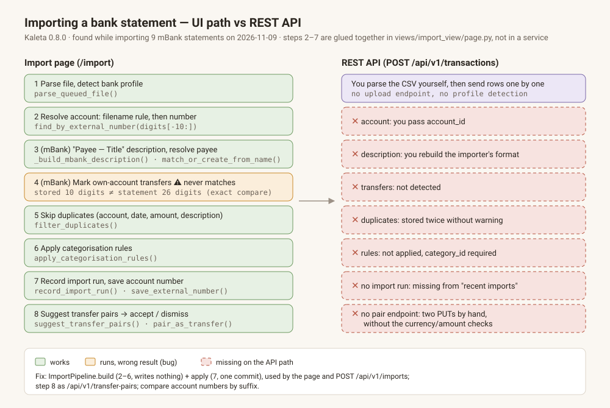

# POST /api/v1/imports — import a bank statement through the API

## Intent

This plan is the second half of the bug fix started in `import-pipeline-service`.
Kaleta 0.8.0 has no import endpoint. The only way to load statement rows
through the API is `POST /api/v1/transactions`, which stores one row exactly as
sent. That skips steps 1–8 in the image:

- no profile detection or parsing;
- no account match;
- no importer description format, so a later import will not see these rows
  as duplicates, because the duplicate check compares descriptions exactly;
- no transfer detection;
- no duplicate skip;
- no categorisation rules, even though `category_id` is required, so the
  client has to guess;
- no import run, so the file is missing from "Account coverage and recent imports".

On 2026-11-09, 5 rows loaded through the API matched the UI rows only because
the client copied the importer's logic by hand.

Depends on: `import-pipeline-service`.

## Scope

In scope:

1. **Route:** `POST /api/v1/imports`
   - **Raw body, not multipart.** The body is the statement file as
     `Content-Type: text/csv` or `application/octet-stream`. Options go in
     query parameters:
     - `filename` (required; used for rules and the import run),
     - `account_id`,
     - `default_expense_category_id` (required),
     - `default_income_category_id` (required),
     - `skip_duplicates` (default `true`),
     - `dry_run` (default `false`).

     Why not multipart: FastAPI parses form data **before** dependencies run,
     including the router's `require_api_auth`. An unauthenticated client could
     then upload any size, and Starlette spools files over 1 MB to temporary
     disk, so plain-text statements would land on disk.
   - **Read only after auth.** First reject on `Content-Length` greater than
     `settings.max_upload_bytes`. Then read `request.stream()` inside the route
     with a running byte count and stop with `413` when it passes the cap.
     Never write the body to disk.
   - **Row cap for the API:** `settings.api_import_max_rows` (default 5 000).
     Above it, return `413` with the row count. This bounds the per-row payee and
     duplicate queries in one request.
2. **Semantics**
   - `dry_run=true` returns `ImportPipeline.build` as JSON: the rows with final
     description, type, category, payee and a duplicate flag, the
     `new_payee_names`, the resolved account, and the transfer window. Nothing is
     written.
   - `dry_run=false` runs `build` and then `apply`, in one transaction.
3. **Idempotency**
   - An optional `Idempotency-Key` header is stored on the `ImportRun`. A repeat
     with the same key returns the first result with `200` and does not import
     again.
   - In addition, `ImportRun.file_hmac` stores a keyed HMAC of the body, keyed
     with a server secret so the digest does not reveal the content. The same
     file again for the same account returns `409` with the earlier run id,
     unless `allow_reimport=true`.
   - While importing, a PostgreSQL advisory lock is held per (family, account),
     so two concurrent requests cannot both pass the duplicate check.
   - Alembic migration: add `idempotency_key` and `file_hmac` (both nullable,
     with an index) to `import_run`.
4. **Responses** (Pydantic schemas in `src/kaleta/schemas/imports.py`):
   - `ImportRowPreview`: `date`, `amount`, `type`, `description`,
     `category_id`, `payee_name`, `duplicate: bool`.
   - `ImportDryRunResponse`: `account_id`, `profile`, `rows: list[ImportRowPreview]`,
     `new_payee_names`, `transfer_window: {date_from, date_to}`.
   - `ImportResponse`: `import_run_id`, `account_id`, `imported_count`,
     `skipped: list[{row_index, reason}]`, `transfer_window`.
   - Errors use the shared shape `{"error": {"code", "message"}}`:
     - `401`/`403` for auth;
     - `409` for an ambiguous account number or a duplicate file;
     - `413` when over the byte cap or the row cap;
     - `422` for readiness errors: no account, no categories, currency mismatch,
       a generic CSV without a saved mapping (the response lists the detected
       headers), or an unknown profile;
     - `423` when the data key is locked. A bearer import needs the token
       owner's key to be unlocked (`_bind_bearer_data_key`, `api/deps.py`).
       Document this in the endpoint description.
5. **Docs:** add `KAL-API-008` to `docs/bdd.md`, and state in the description of
   `POST /api/v1/transactions` that it does not apply rules or skip duplicates
   and that statements should use `/imports`.

Out of scope:

- Applying rules on plain `POST /api/v1/transactions`.
- An API for creating or editing categorisation rules.
- Transfer pair endpoints (`import-transfer-pairs-api`).
- Saving filename rules through the API.

## Acceptance criteria

- `uv run pytest tests/integration/test_api_imports.py -q`
- Migration parity: `test_the_migration_adds_what_the_model_declares` in
  `tests/integration/test_api_imports.py` (run by the first criterion); see
  Implementation notes for why it replaces `uv run alembic upgrade head && uv run alembic check`.
- `uv run lint-imports`
- `grep -c "KAL-API-008" docs/bdd.md | grep -qE '^[1-9]'`
- `uv run python scripts/spec_coverage.py`

Tests in `tests/integration/test_api_imports.py`:

- `test_import_mbank_statement_happy_path` asserts literal stored descriptions
  and categories.
- `test_dry_run_writes_nothing`.
- `test_same_file_twice_returns_409`; `test_idempotency_key_replays_result`.
- `test_unauthenticated_upload_rejected_before_body_read`.
- `test_body_over_cap_413`; `test_rows_over_cap_413`.
- `test_no_account_422`; `test_ambiguous_number_409`.
- `test_concurrent_imports_do_not_double_insert` (two tasks, one advisory lock).

## Touchpoints

- `src/kaleta/api/v1/imports.py` (new), `src/kaleta/api/v1/__init__.py`
- `src/kaleta/schemas/imports.py` (new)
- `src/kaleta/models/import_run.py` + an Alembic migration
- `src/kaleta/config/settings.py` — `api_import_max_rows`, the HMAC secret
  (reuse the existing app secret if one exists)
- `src/kaleta/services/import_pipeline.py` — `file_hmac`, the lock
- `tests/integration/test_api_imports.py`, `docs/bdd.md`

## Open questions

- Rate limiting: reuse the existing per-token limiter if there is one, or add a
  stricter one for `/imports`. Decide when implementing; it does not block the start.

## Implementation notes

- **`alembic check` → a parity test.** `uv run alembic upgrade head && uv run
  alembic check` cannot run in this environment: it connects to the default
  `localhost:5432` and needs a family schema at head (the same finding as
  `archive/gifts-grid.md`). Its intent is now an executable test:
  `test_the_migration_adds_what_the_model_declares` reads `import_runs` from the
  suite family's schema, which the real migrations build, and compares every
  column and its nullability with `ImportRun`, plus the two new indexes.
- **Migration `e7a3c5b19d42`.** Adds `import_runs.idempotency_key`
  (`String(200)`) and `import_runs.file_hmac` (`String(64)`, hex), both nullable
  and indexed. Runs from the import page, and every earlier run, have neither.
- **Where the logic lives.** The route (`api/v1/imports.py`) only reads the body
  and maps results to schemas. Parsing an upload, the row cap, the file HMAC,
  the advisory lock and the idempotency replay are `ImportPipeline` methods
  (`parse_upload`, `check_row_cap`, `file_digest`, `lock_account`,
  `preview_upload`, `import_upload`, `preview_rows`), next to `build`/`apply`.
- **Body reading.** No body parameter is declared, so FastAPI reads nothing
  before `require_api_auth`. The route refuses a `Content-Length` over
  `max_upload_bytes`, then streams with a running count and stops at the cap,
  so a chunked body with no length is bounded too. `413` comes from a new
  `PayloadTooLargeError` (mapped in `kaleta_error_http_status`).
- **Parsing.** The profile is detected from the content, as on the page; the
  API takes no `profile` parameter, so "unknown profile" cannot occur and has no
  error of its own. A generic CSV uses the column mapping of the matching
  filename rule; without one, a file the header aliases cannot map is `422`
  (`import_needs_mapping`) and the message lists the detected headers.
- **HMAC.** `HMAC-SHA256(key, file)` where `key = HMAC-SHA256(secret_key,
  "kaleta/import-run/file-hmac/v1")`: the existing app secret, domain-separated
  so the digest does not share its key with other uses.
- **Lock.** `pg_advisory_xact_lock(crc32(family schema), account_id)`, taken
  after the account is resolved and before the duplicate checks; the commit in
  `apply` (or the rollback on any error) releases it. The idempotency key and the
  same-file check are looked up again under the lock, so a twin request that
  finished while this one waited is replayed or refused, not imported twice.
  `test_concurrent_imports_do_not_double_insert` uses two real connections; with
  the lock removed it fails (checked by hand, three runs out of three).
- **Idempotency replay.** A repeat returns `200` with `replayed: true`, the
  first run's id, imported and skipped counts. The run does not store which rows
  were skipped, so `skipped` is empty on a replay and `skipped_count` (a field
  added to `ImportResponse` for this) carries the number. The transfer window is
  recomputed from the run's row dates. Keys are per family (the run's schema).
- **Status codes.** `201` for an import, `200` for `dry_run` and for a replay.
  The path follows the other routers: `POST /api/v1/imports/`.
- **Pairing window.** The API uses the default transfer pairing window; the
  user's setting lives in the browser's storage, which a bearer request does
  not have.
- **Dry run.** `skip_duplicates=false` marks no row as a duplicate (the check is
  not run). A skipped mBank row shows its payee only when the payee already
  exists.
- **Open question — rate limiting, decided: none added.** There is no per-token
  limiter in the API today (only the sign-in limiter). One request is bounded by
  the byte cap, the row cap and the per-account lock; a limiter for the whole API
  is its own piece of work.

## Implementation (filled by plan-archiver)
