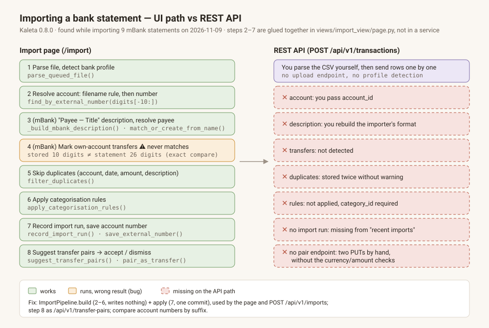

# Detect own-account transfers on mBank import (stored number vs statement number)

## Intent

When an mBank statement row moves money to or from one of the user's own
accounts, the import is meant to store it as a `transfer`. In production this
never happens. On 2026-11-09 nine mBank statements (143 rows, 10 own-account
transfers) were imported; every preview showed `Transfers: 0` and all 10
transfers were stored as expense/income, then paired by hand in "Suggested
transfers".

Root cause — two parts of the import disagree about the account number:

- `AccountService.save_external_number` (`src/kaleta/services/account_service.py:288`)
  keeps only the **last 10 digits** (`number[-10:]`, e.g. `0278886836`) — and
  overwrites, on every mBank import, a full number the user typed in Settings.
- `is_counterparty_transfer` (`src/kaleta/services/import_service.py:108`) and the
  loop in `to_transaction_creates_with_payees` (`import_service.py:~1947`) test
  `counterparty_digits in known` — exact equality against the statement's full
  26-digit NRB (`55114020040000330278886836`).

The unit tests (`TestToTransactionCreatesWithPayees`, and
`test_current_account_fixture_parses_transfer_counterparty` in
`tests/unit/services/test_mbank_real_exports.py:57`) seed the full 26 digits — a
value production never stores — so they pass.

A second, smaller gap: `known_digits` is built once when `/import` loads
(`src/kaleta/views/import_view/page.py:105`). A number learned from file 1 of a
batch never reaches files 2..n — exactly the "first import of all accounts" case.

`AccountService.find_by_external_number` (`account_service.py:262`) already does
the right comparison for account auto-match: decrypted stored number
`endswith(wanted)`, narrowed by the 8-digit blind index (`ACCOUNT_SUFFIX_DIGITS = 8`,
`src/kaleta/db/types.py:431`, ADR-20).

## Scope

In scope:

1. **Stop truncating.** `save_external_number` stores the full digits it is given
   (`digits_only` from `kaleta.db.types`). Existing 10-digit values stay valid
   (see rule below); no data migration. The blind index hashes the last 8 digits,
   so it is unaffected.
2. **One matching rule, shared.** A helper in `kaleta.db.types` (next to
   `digits_only` and `ACCOUNT_SUFFIX_DIGITS`), e.g.
   `account_number_matches(stored, statement) -> bool`:
   - both normalised with `kaleta.db.types.digits_only`;
   - the statement number must be at least 26 digits (a full NRB/IBAN body);
     shorter values — references, masked card numbers, generic-CSV columns — never match;
   - `stored` must be at least `ACCOUNT_SUFFIX_DIGITS` digits;
   - match = `statement.endswith(stored)` (equal when both are full).
   `find_by_external_number` keeps its own direction (stored ends with the
   searched digits) but uses the same normaliser. Remove the duplicate
   `digits_only` in `import_service.py:98` and the inline `re.sub(r"\D", ...)`
   at `import_service.py:~1947`.
3. **Use it everywhere a counterparty is compared:** `is_counterparty_transfer`,
   `to_transaction_creates_with_payees`. `build_known_account_digits` returns the
   normalised stored numbers (any length ≥ 8).
4. **Never match the target account itself** (a row on account X whose
   counterparty is X is not an internal transfer): pass the target account's
   number and exclude it.
5. **Preview agrees with commit.** Only the mBank commit path detects transfers
   (`to_transaction_creates` for generic/PKO/Wise does not). The preview's
   transfer classification (`classify_row_preview_type`, `count_row_types`) is
   applied only when `profile == "mbank"`; other profiles show income/expense, as
   they will be stored.
6. **Fresh known numbers per file.** Rebuild `known_digits` from the accounts
   before each preview render and each `_persist`, so numbers saved by earlier
   files in the batch count.

Out of scope:

- Pairing the two legs at import time — "Suggested transfers" does that.
- Card repayments (`RĘCZNA SPŁATA KARTY KREDYT.`), which carry no account number.
- Transfer detection for non-mBank profiles.

## Acceptance criteria

- `uv run pytest tests/unit/services/test_import_service.py -q`
- `uv run pytest tests/unit/services/test_mbank_real_exports.py -q`
- `uv run pytest tests/unit/db -q -k account_number_matches`
- `uv run pytest tests/unit/services/test_import_service.py -q -k "stored_suffix or short_counterparty or own_target"`
- `./scripts/verify.sh --e2e`
- `grep -c "KAL-CSV-039" docs/bdd.md | grep -qE '^[1-9]'`
- `uv run python scripts/spec_coverage.py`
- `[manual]` Import one mBank statement with a `PRZELEW WŁASNY` to a registered
  account: preview shows `Transfers: 1`+, stored row is `type = transfer`,
  `is_internal_transfer = true`.

## New tests

Names fixed so the criteria above select them:

- `test_stored_suffix_matches_full_statement_number` — known `"0278886836"`,
  counterparty `"55 1140 2004 0000 3302 7888 6836"` → transfer.
- `test_short_counterparty_never_matches` — counterparty `"0278886836"` (10 digits) → not a transfer.
- `test_own_target_account_is_not_a_transfer`.
- `test_account_number_matches_*` unit tests for the helper.
- `test_mbank_real_exports.py::test_current_account_fixture_parses_transfer_counterparty`
  changed to seed the 10-digit suffix (`current-account-sample.csv:38` already has
  the statement header; no new fixture).
- `test_save_external_number_keeps_full_digits`.

## Touchpoints

- `src/kaleta/db/types.py` — `digits_only`, new `account_number_matches`
- `src/kaleta/services/account_service.py` — `save_external_number`, `find_by_external_number`
- `src/kaleta/services/import_service.py` — `build_known_account_digits`,
  `is_counterparty_transfer`, `classify_row_preview_type`, `count_row_types`,
  `to_transaction_creates_with_payees`; drop local `digits_only`
- `src/kaleta/views/import_view/page.py` — rebuild `known_digits` per file; pass profile to preview
- `src/kaleta/views/import_view/preview_section.py` — profile-aware counts
- tests listed above; `docs/bdd.md` — `KAL-CSV-039` (`@automated`, `Covers:` in the tests)

## Open questions

None blocking. Decided:

- Width: no new constant. Match on "statement ends with stored", stored ≥ 8
  digits (the blind-index width), statement ≥ 26.
- Non-PL IBANs: an IBAN body is ≥ 26 characters for most EU countries; shorter
  ones (e.g. some EEA) simply never match. Accepted; note in the helper docstring.
- Wise: Wise rows go through `to_transaction_creates`, so they are not affected.

## Implementation notes

- **The rule.** `kaleta.db.types.account_number_matches(stored, statement)`:
  both sides reduced with `digits_only`; the statement needs at least 26
  digits, the stored value at least `ACCOUNT_SUFFIX_DIGITS` (8); a match is
  `statement.endswith(stored)`. The 26 is written in the helper with its
  reason (a full NRB / most EU IBAN bodies; shorter IBANs never match),
  following the plan's "no new constant" decision.
- **One normaliser.** `import_service`'s own `digits_only` (`re.sub(r"\D")`)
  is gone. It imports `digits_only`, `ACCOUNT_SUFFIX_DIGITS` and
  `account_number_matches` from `kaleta.db.types`, as `account_service`
  already did. `find_by_external_number` keeps its direction (stored ends
  with the searched digits) and was already on that normaliser.
- **Signatures.** `classify_row_preview_type`, `count_row_types`,
  `build_preview_table_rows` and `PreviewSection.render` take a keyword-only
  `profile` (required, so no caller can forget it) and an optional
  `target_digits`. `is_counterparty_transfer` takes `target_digits`, and
  `to_transaction_creates_with_payees` takes `target_account_digits`. The
  existing tests that called these without `profile` now pass
  `profile="mbank"`; their assertions are unchanged.
- **Target account.** The number excluded is the statement's own
  (`metadata.account_number_digits`, which is the account being imported
  into), else the target account's stored number.
- **Fresh numbers per file.** The import page keeps `external_numbers`
  (account id → stored number). `_persist` reloads it from the database
  before building the creates of an mBank file, so numbers saved by earlier
  files or in Settings count. After `save_external_number` it records the new
  number in the map, so the next preview render sees it without a reload.
  The preview render reads the map, not the database, because it is
  synchronous.
- **Auto-match unchanged.** `_auto_match_account` still searches by
  `digits[-10:]`. With the full number now stored, "stored ends with the last
  10" still holds, and old 10-digit values are matched as before (unit test
  `test_save_external_number_still_finds_by_ten_digit_tail`).
- **`save_external_number`** stores `digits_only(number)`. Existing 10-digit
  values stay valid under the rule, so there is no migration.
- **The plan file was reorganised, not changed.** The "New tests" list sat
  inside `## Acceptance criteria`, and its bullets start with a backtick, so
  the DoD gate read each test name as a shell command (gate attempt 1:
  "command not found"). The list now has its own `## New tests` heading. Its
  content is unchanged, and the criteria that run those tests
  (`pytest … -k "stored_suffix or short_counterparty or own_target"`,
  `-k account_number_matches`, and the whole `test_mbank_real_exports.py`)
  are unchanged.
- **"Assertions removed" (gate warning) - none were.** The flagged lines in
  `tests/unit/services/test_import_service.py` are six existing asserts and
  calls in `TestPreviewClassification` and `TestMBankFinalDescription` whose
  call gained the now-required `profile="mbank"` keyword
  (`classify_row_preview_type(row, known)` became
  `classify_row_preview_type(row, known, profile="mbank")`, and likewise for
  `count_row_types` and `build_preview_table_rows`). Each `assert` line was
  rewritten in place with the same expected value, so the diff shows it as
  removed and added. No assertion was dropped or loosened.
- **Tests.**
  - The plan's named unit tests are in `test_import_service.py`,
    `tests/unit/db/test_account_number_matches.py` and
    `test_account_service.py`.
  - `test_current_account_fixture_parses_transfer_counterparty` now seeds the
    10-digit tail `9939999901`.
  - Preview gating per profile and target exclusion are also covered.
  - KAL-CSV-039 is covered by the e2e test
    `test_mbank_transfer_detected_against_stored_suffix_and_earlier_file`
    (`tests/e2e/test_transfer_detection.py`). It uses two new fixtures with
    their own account numbers, so it cannot collide with KAL-CSV-004's
    accounts in the shared e2e database. The savings account holds only the
    10-digit tail. File 1 is a transfer to it. File 2, on the same page with
    no reload, is a transfer back to file 1's account, whose number only file
    1's import stored. Run against `main`'s `src/`, that e2e test fails
    (`Transfers: 1` never appears).
- **Gate attempt 2: e2e failures outside this change, not reproduced.**
  The gate's `verify.sh --e2e` run had 7 failures, all in the ledger e2e tests
  (`test_transactions.py` ×6, where the token search found 3 rows instead of 2,
  and `test_transactions_keep_place.py` ×1, a `409 Conflict` seeding a
  category). None of them touch the import page or this diff. On the same
  commit they pass:
  - on their own (17 passed);
  - after `test_transfer_detection.py` (21 passed) and after every `test_s*.py`
    file (48 passed);
  - in a full `pytest tests/e2e/` run (273 passed, 0 failed).
  Recorded as an order-dependent flake in `docs/plans/chores.md`, not fixed
  here (scope).

## Implementation (filled by plan-archiver)
