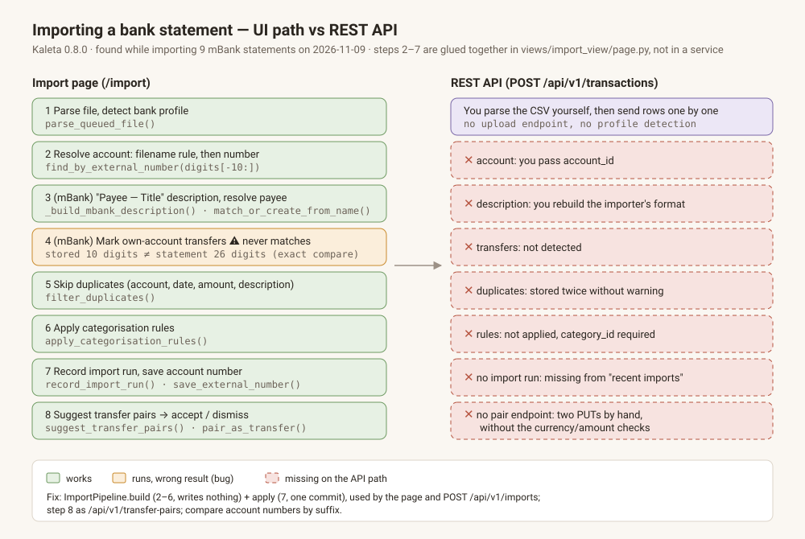

# Move the import pipeline out of the view into one service (build, then apply once)

## Intent

This plan is the first half of a bug fix. The REST API cannot import a bank
statement the way the import page does, because the import is orchestrated in
the view, not in a service. The steps (numbered as in the image) are:

1. parse and detect the profile — `ImportService.parse_queued_file` (`import_service.py:1459`);
2. resolve the account — filename rule `ImportRuleService.match` (`page.py:~363`),
   then mBank number `AccountService.find_by_external_number` (`page.py:353`);
3. *(mBank only)* description and payee — `to_transaction_creates_with_payees`;
   other profiles use `to_transaction_creates` (no payees);
4. *(mBank only)* own-account transfers — inside `to_transaction_creates_with_payees`;
5. skip duplicates — `filter_duplicates`;
6. categorisation rules — `apply_categorisation_rules`;
7. write — `record_import_run`, `TransactionService.create_bulk`,
   `AccountService.save_external_number`;
8. suggest transfer pairs — `suggest_transfer_pairs` over `transfer_review_window`.

Steps 2–7 are glued together in `_persist` and `handle_upload` inside
`src/kaleta/views/import_view/page.py` (~lines 350–605), against AGENTS.md
("Services contain business logic; views and API routes stay thin"). The API is
not allowed to import views (`pyproject.toml` import-linter contract
`api-no-views`), so it has nothing to call.

There is also a correctness problem in today's step 7: payee creation flushes,
`create_bulk` commits, and `save_external_number` commits again. A failure after
the first commit leaves stored rows without an import run, or orphan payees.

This plan changes no behaviour on the page. The endpoint is
`import-api-endpoint`, which depends on this plan.

## Scope

In scope:

1. **`ImportPipeline` service** (`src/kaleta/services/import_pipeline.py`) with two
   methods:
   - `build(parsed_file, options) -> ImportPlan`: the read-only steps 2–6. It
     resolves the account, builds creates, marks duplicates, applies rules, and
     computes the transfer window. It writes **nothing**. Payees that do not
     exist yet are returned as `new_payee_names`; they are not created.
     `options` holds `account_id` (optional), the default expense and income
     category ids, `skip_duplicates`, and `filename`.
   - `apply(plan) -> ImportResult`: step 7 in **one** transaction. It creates
     the new payees, creates the rows, records the import run and saves the
     account number, then commits once. On error it rolls back everything.
2. **Account resolution order (explicit):** explicit `account_id` → filename rule →
   mBank account number. An ambiguous number raises `ConflictError` (unchanged).
3. **Readiness:** `build` calls `validate_import_readiness` (`import_service.py:361`)
   and raises the same typed errors the page shows today. This covers missing
   account, missing default categories and currency mismatch. Both default
   categories stay required, as on the page.
4. **Known account numbers** are read inside `build` from the accounts on every
   call (no page-load cache — see `import-mbank-transfer-account-suffix`).
5. **Constants move to the service layer.** `DEFAULT_TRANSFER_PAIRING_DAYS` and
   `DEFAULT_TRANSFER_AMOUNT_TOLERANCE` move from `views/settings/constants.py:20–21`
   into the services, and the views re-export them. The upload size check uses
   `settings.max_upload_bytes`; `views/import_view/upload_guard.py` keeps the UI
   message.
6. **The page calls the service:** `_persist` becomes `build` + `apply`, and
   `handle_upload` uses the pipeline's account resolution. Saving and touching
   remembered filename rules stays in the view, because it is a UI choice.
7. **`ImportResult`** holds `imported_count`, `skipped` (rows with reasons),
   `import_run_id`, and `transfer_window` (from `transfer_review_window`, widened
   over all parsed rows as the page does today).

Out of scope:

- Any HTTP endpoint (`import-api-endpoint`).
- Behaviour changes on the page: same rows, same counts, same messages.

## Acceptance criteria

- `uv run pytest tests/unit/services/test_import_pipeline.py -q`
- `uv run pytest tests/integration/test_import_pipeline.py -q`
- `uv run pytest tests/unit/services/test_import_service.py -q`
- `uv run lint-imports`
- `./scripts/verify.sh --e2e`
- `grep -c "apply_categorisation_rules\|filter_duplicates\|record_import_run\|create_bulk" src/kaleta/views/import_view/page.py | grep -qx 0`

New tests:

- Build: `test_build_writes_nothing` checks that the row, payee and import-run counts
  are unchanged after `build`.
- Apply: `test_apply_is_atomic` injects a failure in `save_external_number`. No rows,
  payees or import run must remain.
- Resolution: `test_account_resolution_order` checks that explicit beats rule and rule beats number.
- Golden: `test_pipeline_matches_golden_rows` imports `current-account-sample.csv` and
  compares the stored descriptions, types and categories with fixed literal
  expectations (Working Agreement rule 11: BDD literals, not "same as before").

## Touchpoints

- `src/kaleta/services/import_pipeline.py` (new); `src/kaleta/services/import_service.py`
- `src/kaleta/services/account_service.py`: `save_external_number` must not
  commit itself when called from `apply` (add `commit: bool = True`)
- `src/kaleta/services/payee_service.py`: create without commit inside `apply`
- `src/kaleta/views/import_view/page.py`, `views/settings/constants.py`
- tests above; `docs/architecture.md` (import flow paragraph)

## Open questions

- Should `ImportPlan` be serialisable (for a later "upload, review, confirm"
  API flow)? Not needed now. Keep it a plain dataclass with no ORM objects so
  the option stays open.

## Implementation notes

- **Names.** The plan's `ImportResult` is `ImportOutcome`:
  `import_service.ImportResult` already exists as the parser's result, and two
  service classes with one name would be read as one. Fields as the plan lists
  (`imported_count`, `skipped`, `import_run_id`, `transfer_window`), plus
  `account_id`, `saved_account_number` and `created_payee_count`. `options` is
  `ImportOptions`; `parsed_file` is the parser's own `ParseQueuedFileResult`.
- **Build writes nothing, payees included.** `PayeeService.match_from_name()`
  is steps 1–3 of `match_or_create_from_name()` (which now calls it), so `build`
  can tell an existing payee from a new one without creating it.
  `ImportService.draft_creates_with_payees()` returns `(create, new_payee_name)`
  per row; `to_transaction_creates_with_payees()` is now that draft plus
  creating the missing payees, unchanged for its existing callers. The new name
  is kept beside the create, not in `TransactionCreate.payee_name`: that field is
  capped at 200 characters and a bank's payee column is not.
- **Rules see a payee that is not created yet.** `apply_categorisation_rules`
  takes `new_payee_names` (aligned with the creates) so a rule on a payee name
  still matches in `build`. The name used is the cleaned raw name, which is what
  `match_or_create_from_name` stores for a new payee.
- **One commit.** `apply` creates payees (flush), stages the rows
  (`create_bulk(commit=False)`), the run (`record_import_run`) and the number
  (`save_external_number(commit=False)`), flushes for the run id and commits once;
  any exception rolls back and re-raises (`test_apply_is_atomic`).
- **Two behaviour differences, both corner cases, both deliberate:**
  - *Payees of skipped duplicates are no longer created.* The old flow created
    every row's payee before dropping duplicates, which left a payee behind for
    a row that was never stored — one of the orphans the plan's Intent names.
  - *A filename rule now beats the mBank number on the page too.* The page used
    to let the statement number override the account a rule had set (and an
    inherited or bulk default). The plan fixes the order explicit → rule →
    number; the page now asks `resolve_account`, so a rule wins, while the
    number still overrides an inherited or bulk default as before. "Remember
    mapping" starts unticked exactly when the number points at the chosen
    account (`number_account_id`), so a rule and number that agree behave as
    before.
- **What stays in the view.** A cleared account fails with the same
  "Select a target account" message before the pipeline is called — otherwise
  `build` would quietly resolve one by rule or number. Saving/touching the
  remembered filename rule, the queue and the per-batch `external_numbers` used
  by the preview (updated from `ImportOutcome.saved_account_number`) are UI.
  Readiness errors come back as `ValidationError` with the old i18n key and
  params; the page shows them through `resolve_toast_text`, so the text is the
  same.
- **Known numbers** are listed from the accounts inside every `build`; the page's
  old "refresh before an mBank import" loop is gone with `_persist`.
- **Constants.** `DEFAULT_TRANSFER_PAIRING_DAYS` / `DEFAULT_TRANSFER_AMOUNT_TOLERANCE`
  are defined in `transaction_service.py` and re-exported by
  `views/settings/constants.py` — the same lines `import-transfer-pairs-api` adds,
  so whichever branch merges second resolves a trivial conflict in those two files.
- **Acceptance list format.** The DoD gate runs every acceptance bullet that
  starts with a backtick as a shell command, so the four "New tests" bullets were
  read as commands. They now start with a word ("Build:", "Apply:", …); the test
  names and the tests are unchanged and run under the first two criteria.
- **Upload limit.** `import_pipeline.upload_exceeds_limit(size)` holds the
  `settings.max_upload_bytes` check; `upload_guard.upload_exceeds_cap` keeps the
  UI's `size()` probe and calls it.

## Implementation (filled by plan-archiver)
- **KAL-CSV-039 e2e race (gate attempt 1, after the rebase).** In one full
  `verify.sh --e2e` run, `test_mbank_transfer_detected_against_stored_suffix_and_earlier_file`
  failed on its second file: the Preview panel stayed hidden although the
  snapshot showed all three settings filled and the Preview node clickable.
  The test's `_step` clicked the node right after the last select, and a click
  sent before the server has that choice is dropped (the node is not yet
  walkable). It now waits for `cursor-pointer` first, like `_step` in
  `test_csv_import.py` always has. The view and the pipeline are unchanged by
  this; the file passes alone and in the import e2e subset (38/38).
  Gate attempt 2 hit the same drop in `test_rules.py::test_rules_apply_during_csv_import`
  (its `_import_step(page, 5)` right after the last select). The two other
  helpers that clicked a step node without waiting (`test_rules.py`,
  `test_transfer_section_layout.py`) now wait for `cursor-pointer` too; the
  Format/Upload clicks elsewhere stay as they are, those nodes are always
  walkable. No view or service code is involved: the settings handlers are
  untouched by this branch.
